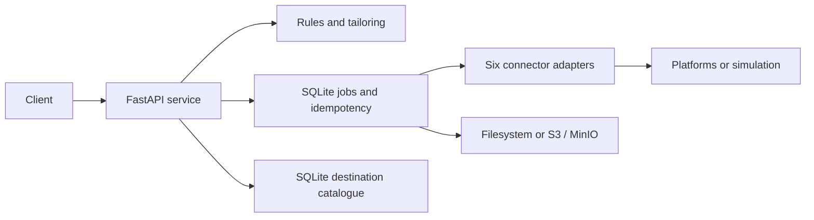

# IncuBrix Distribution

Configuration-driven distribution to long-tail destinations using six connectors, a destination catalogue, policy enforcement, durable jobs, certification evidence, and recommendation evaluation.

## Quick start

Requirements: Python 3.11+ for local development, or Docker Desktop with Compose.

```powershell
Copy-Item .env.example .env
docker compose up --build
```

The dashboard and API listen on `http://localhost:8000`; interactive docs are at `/docs`. The dashboard shows health/readiness, connectors, and destinations, and lets you run local simulation jobs when `SIMULATION_MODE=true`. Compose binds exposed services to loopback. It starts the application, MinIO, PostgreSQL/Pictrs/Lemmy, and Ghost. Platform accounts and credentials are not provisioned. Keep `SIMULATION_MODE=true` for safe runs; live publishing requires credentials and explicit authorization for the target sandbox. The dashboard disables publish actions when simulation mode is off.

For local Python development:

```powershell
python -m venv .venv
.\.venv\Scripts\Activate.ps1
python -m pip install -r requirements-dev.txt
python -m uvicorn app.main:app --reload
```

Open `http://127.0.0.1:8000/` for the dashboard, or `http://127.0.0.1:8000/docs` for the API explorer. The dashboard runs safely with the default simulation configuration.

`.env.example` contains local placeholders, not real credentials. `SERVICE_API_TOKEN` optionally protects application APIs; health/readiness and docs remain public. Connector secrets belong only in environment variables.

## Architecture

- `app/main.py`: FastAPI routes, validation, correlation, API protection, and worker lifecycle.
- `app/connectors.py` and `connectors/*.yaml`: Appendix A contract, adapters, error mapping, and surface/rate metadata.
- `app/policy.py`: destination restrictions, relevance scoring, and rendition tailoring.
- `app/jobs.py`: SQLite-backed idempotency, publication, certification, recovery, and recertification.
- `app/catalogue.py`: CSV validation/import and reachability checks.
- `app/storage.py`: local filesystem or S3-compatible object storage.
- `app/batch.py`: batch CLI for JSON publication requests.
- SQLite stores catalogue, jobs, posts, certifications, idempotency, and audit records. Compose uses MinIO for object results; local runs use filesystem storage.



## API use

Business routes are under `/api/v1/`. The Appendix A connector dispatcher is `POST /connector/v1/{connector_key}/{method}`; consult each manifest for its exact methods and request/response fields. Every POST requires `Idempotency-Key`. Long publication, import, and certification operations return HTTP 202 with job links; poll `GET /api/v1/jobs/{job_id}` then fetch `/result`. Errors use `{ "error": { "code", "message", "retryable", "details" } }`.

Error codes: `DEST_SPEC_VIOLATION`, `DEST_RULE_FREQUENCY_CAP`, `CONNECTION_AUTH_EXPIRED`, `PLATFORM_RATE_LIMIT`, `PLATFORM_QUOTA_EXHAUSTED`, `PLATFORM_CONTENT_REJECTED`, `PLATFORM_UNAVAILABLE`, `CONNECTOR_DISABLED`, `IDEMPOTENCY_CONFLICT`, `DESTINATION_NOT_FOUND`, `CONNECTOR_NOT_FOUND`, `METHOD_NOT_SUPPORTED`, `CERTIFICATION_FAILED`, `INVALID_REQUEST`, `STORAGE_UNAVAILABLE`, and `JOB_NOT_FOUND`.

Key routes include `/health`, `/ready`, `/api/v1/connectors`, `/api/v1/destinations`, `/api/v1/publications`, `/api/v1/certifications`, `/api/v1/recommendations`, `/api/v1/assets`, and `/api/v1/errors`. The complete schema is generated from the running FastAPI application at `/openapi.json` or checked in as `openapi.yaml`.

## Safe simulation and certification

Simulation is enabled by default and stores posts locally. Create a destination, then submit publication/certification requests with unique idempotency keys. Automated certification simulates publish, status, and delete for Discourse, Lemmy, DEV.to, Ghost, and signed webhook; assisted produces a build-assist pack. Evidence says `simulation` and is not provider certification or proof of a live post. Live calls need user-provided credentials and target sandbox authorization. DEV.to's API unpublishes an article to draft; it does not erase the provider record.

Rules extraction produces a proposal; a person must confirm it. Imported rules start unconfirmed. CSV import normalizes and deduplicates, validates URLs and row fields, checks reachability, and reports row errors. Recommendation evaluation consumes supplied labeled cases; no labeled set is included.

## Batch runner

Provide one JSON request file or a folder of JSON files containing `destination_id` and `rendition`:

```powershell
python -m app.batch .\inputs .\batch-results --api http://localhost:8000
```

Each input gets a result JSON and the output folder gets `index.json`.

## Verification

```powershell
python -m pytest -q
ruff check app tests
ruff format --check app tests
python -m scripts.export_openapi
python -c "import yaml; from openapi_spec_validator import validate; validate(yaml.safe_load(open('openapi.yaml', encoding='utf-8')))"
docker compose config
```

Coverage includes contracts, policies, import, idempotency, failure handling, simulated certification evidence, assets, health/readiness, and OpenAPI. Actual run results are recorded in `REPORT.md`.

## Submission limits

The original Excel Submission Form is preserved; `IncuBrix_Submission_Completed.xlsx` is a separate evidence copy with user-specific declaration/signature fields left for review. The requested 150 researched real destinations require research and evidence not included in this project. A live demo, hosted private repository, and video require external account/deployment access. Local simulation evidence is not live-community certification. See `REQUIREMENTS.md` and `REPORT.md` for tracked status.
